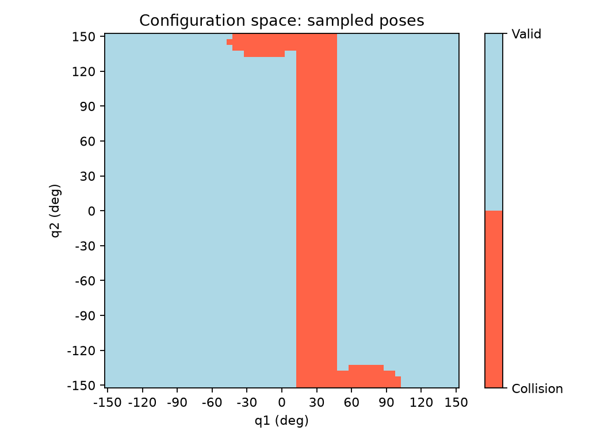

# 平面二连杆机械臂避障规划与轨迹跟踪系统

以平面二连杆为起点，实现从运动学、全连杆碰撞检测、路径规划，到轨迹生成与仿真控制的机器人实验项目。

**当前已实现：运动学、碰撞检查、A*、RRT-Connect 和路径简化。** 时间轨迹、动力学与控制尚在后续计划中。

## 项目交付

目标是形成可复现的规划与控制闭环：

```text
起终点与障碍物
    ↓
路径规划 → 路径简化 → 时间轨迹
    ↓
MuJoCo 动力学跟踪
    ↓
误差、力矩、障碍间隙与执行结果
```

| 交付内容 | 当前状态 |
| --- | --- |
| 二连杆运动学与数值验证代码 | 已实现 |
| 全连杆碰撞检测、构型空间地图 | 已实现 |
| A*、RRT-Connect 规划器及路径返回 | 已实现 |
| 碰撞约束下的路径简化 | 已实现 |
| 规划实验示例与阶段报告 | 已提供 |
| 五次时间缩放、速度与加速度约束 | 待实现 |
| 参数一致的二连杆 MuJoCo 动力学模型 | 待实现 |
| PD、计算力矩控制与扰动实验 | 待实现 |
| 多场景统一评测与完整演示 | 待完成 |

## 已实现模块

### 运动学

- DH 正运动学：由关节角计算末端位姿。
- 解析逆运动学：双解求解与不可达目标判断。
- 雅可比：关节速度与末端速度映射。
- 数值逆运动学：基于伪逆的迭代求解。

### 碰撞检测与构型空间

- 使用点到线段的最近距离，检查圆形障碍物与连杆的碰撞。
- 同时考虑两根连杆、连杆厚度和关节限位。
- 扫描关节角，生成 C-space 有效性地图。
- 对节点间的关节插值进行离散采样，检查中间姿态。



横轴为 q1，纵轴为 q2；地图中的一个点代表机械臂的完整姿态。

### A* 路径规划

- 四邻居网格搜索、欧氏关节距离边代价与启发式。
- 优先队列、较小累计代价更新、过期队列记录跳过。
- 起终点有效性检查、搜索失败返回和父节点路径回溯。
- 已开展 Dijkstra 对照与 75°、25°、5° 网格实验。

### RRT-Connect

- 固定种子的随机关节采样、最近邻查找和限步扩展。
- 单步扩展与朝固定目标连续连接。
- 起点树、目标树交替探索，接通后回溯并拼接路径。
- 无效起终点、搜索预算耗尽与相同起终点处理。
- 返回弧度姿态列表，由实验入口逐段复核。

### 路径简化

- 从当前路点优先连接最远的后续路点，跳过多余姿态。
- 每条捷径重新检查碰撞，失败时保留必要绕行。
- 按最大关节变化量计算采样数量，默认每个关节检查间隔不超过 1°。
- 保留路径端点，输出姿态副本，不修改输入路径。

## 已有实验结果

以下结果限于报告中记录的场景、参数和离散检查设置。

| 实验 | 结果 |
| --- | --- |
| A* 与 Dijkstra，同一 5×5 网格 | 代价均约 3.926991 rad；扩展次数分别为 4、8，不含目标 |
| A* 网格分辨率比较 | 75°、25°、5° 均找到路径，扩展次数分别为 4、23、588 |
| RRT-Connect，固定场景与种子 0～29 | 30/30 找到路径，同种子重复结果一致；返回路径通过采样复核 |
| RRT-Connect，种子 42 | 返回 20 个姿态 |
| 原 RRT 路径简化 | 20 → 2 个姿态，代价约 3.148553 → 2.927006 rad |
| 必须绕障的路径简化 | 4 → 3 个姿态，保留必要中间点，连接复核通过 |

RRT 允许两个关节同时变化，当前 A* 采用四邻居轴向连接，不能仅按以上路径代价判断两者优劣。

## 模型与单位

主实验采用水平平面 2R 机械臂：

| 参数 | 约定 |
| --- | --- |
| 第一杆、第二杆长度 | 0.30 m、0.25 m |
| 基座 | 原点 |
| 零位 | 两杆沿 +X 伸直 |
| 关节角 | q1 相对世界 +X；q2 相对第一杆；绕 +Z 逆时针为正 |
| 关节限位 | 两关节均为 ±150°，不跨边界绕回 |
| 单位 | m、rad、s |
| 基本障碍物 | 圆心 (0.15, 0.08) m，半径 0.04 m |
| 连杆半径 | 0.01 m |

SO-101 是面向后续真机选型的独立探索，目前已在本地完成官方模型加载和关节姿态预览。其尺寸、零位、限位及运动平面不同，尚未接入原二连杆规划与控制闭环，也尚未完成真机迁移。

## 代码与文档

```text
src/
├── armlab/
│   ├── forward_kinematics.py   正运动学
│   ├── inverse_kinematics.py   解析逆运动学
│   ├── jacobian.py            雅可比
│   ├── inverse_jacobian.py    数值逆运动学
│   ├── simple_check.py        连杆与圆碰撞检查
│   ├── is_pose_valid.py       姿态与限位检查
│   ├── edge_check.py          连接采样检查
│   └── astar.py               A* 搜索
└── RRT_Connect.py             单步扩展、Connect、双树搜索

examples/                     实验调用、路径简化与可视化入口
tests/                        运动学回归检查
docs/                         学习路线、实验报告与总结
assets/                       实验图像、记录及本地模型预览资源
configs/                      场景与模型配置目录
```

- [项目范围与验收目标](docs/project-scope.md)
- [连接采样检查实验](docs/experiment-04-edge-check.md)
- [A* 与对照实验](docs/experiment-05-astar.md)
- [RRT-Connect 实验](docs/experiment-06-rrt-connect.md)
- [路径简化实验](docs/experiment-07-path-simplification.md)

## 实现边界

- 当前规划基于已知静态圆形障碍物，未覆盖任意自碰撞、多障碍和完整三维机械臂场景。
- 连接通过有限采样检查，不构成连续运动安全证明。
- RRT-Connect 不保证最短路径，预算耗尽不代表无解。
- 路径尚未附带时间信息，未完成速度、加速度和力矩约束下的实际跟踪。
- 项目使用 AI 辅助讲解、审阅、封装与部分验证，具体范围记录在阶段报告中；目前属于基础算法实现与实验项目，不宣称提出原创规划算法。

## 后续交付

- [ ] 五次时间缩放与轨迹生成。
- [ ] 速度、加速度约束检查。
- [ ] 解析动力学与 MuJoCo 模型交叉验证。
- [ ] PD 与计算力矩控制对照。
- [ ] 力矩限幅、跟踪误差和实际最小间隙分析。
- [ ] 模型误差、外力扰动及多场景统一评测。
- [ ] 汇总实验结果与完整运行演示。
